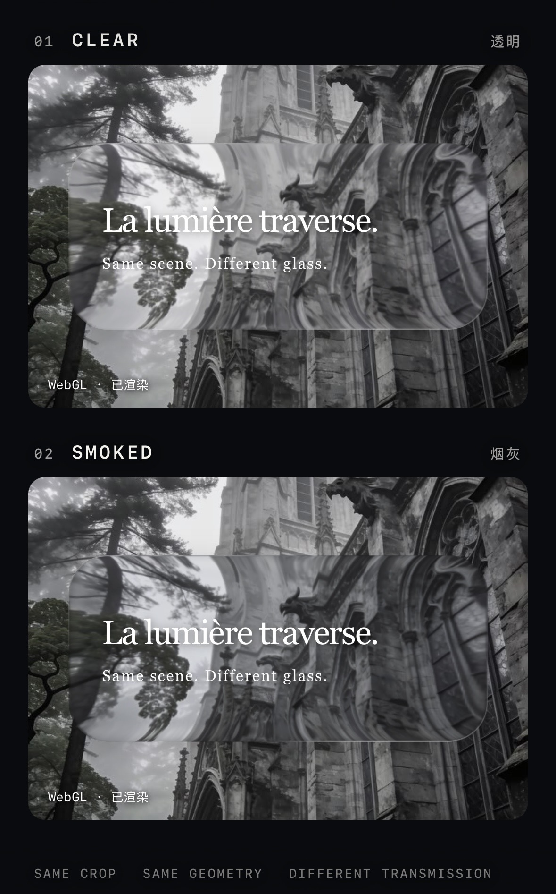

# Layered Liquid Glass Notes



*The production v5 optical engine rendering clear and smoked presets over the same cathedral crop.*

A compact technical note for a full-surface liquid-glass material developed through repeated production UI iterations with CSS, Canvas 2D, WebGL and GLSL.

This repository documents the optics used in the original mobile-first interface. It does not publish a standalone imitation of the component, the private application, private assets, chat logic or personal data.

## Read first

- `docs/liquid-glass-technical-guide-v4.pdf` explains the render chain, equations, material recipes and lifecycle.
- [玻璃为什么显得薄？如何让细节与体积感更明显](docs/appearance-tuning.md) explains the difference between the isolated material sample and the complete interface, with practical tuning steps and CSS examples.
- `CREDITS.md` records the upstream references and the later product-specific work.
- `CHANGELOG.md` records the implementation decisions that survived the Home iterations.

## Rebuild the PDF

Install the figure and PDF dependencies, then run:

```bash
python3 -m pip install reportlab pillow numpy
python3 tools/build_pdf.py
```

The builder writes `docs/liquid-glass-technical-guide-v4.pdf` and uses the bundled, licensed font subset. The material comparison on page 5 embeds an actual phone-browser capture of the production v5 renderer. The full source capture is kept in `assets/material-browser-capture.jpeg`; the builder only crops it for layout and does not repaint the glass. The PDF needs no WebGL support to display that figure.

Page 2 shows an exact, aspect-preserving crop from the supplied reference background. Page 3 calculates ray intersections against the actual rounded rectangle and checks them with an independent signed-distance formula. Page 4 is a sampling-only diagnostic grid calculated from the production v5 displacement formula at fixed time zero; it is explicitly not a browser screenshot or a complete material render. `tools/figure_math.py` rebuilds that grid and validates the geometric boundary positions.

## Current material baseline

```js
{
  refract: 26,
  tint: 0,
  blur: 0,
  edge: 25,
  shine: 13,
  wobble: 15
}
```

These values are tuning controls for this shader, not physical units.

## Material sample and final appearance

The cathedral comparison uses the production v5 optical engine, but its surrounding CSS, background treatment and card dimensions differ from the original interface. It demonstrates refraction and the clear/smoked material presets; it is not a pixel-identical reproduction of the complete UI. The presets also differ in refraction strength, highlight strength and edge treatment, so this is not a transmission-only experiment.

玻璃的厚度感还取决于背景对比、投影、边缘明暗和组件尺寸。想让细节更明显，优先降低背景的视觉干扰、增加有层次的投影，再按实际尺寸调整边缘；单纯增加模糊、折射强度或整圈白边，可能让玻璃变成磨砂板、扭曲背景或发光描边。具体参数与示例见[外观调节说明](docs/appearance-tuning.md)。

## Public scope

The repository shares the engineering approach and selected implementation fragments: one background coordinate system, rounded-rectangle SDF geometry, full-surface refraction, luminance-adaptive edges, clear/smoked material variants, one shared WebGL context and stable 2D snapshots. It is intentionally documentation, not a drop-in component.

## Credits and publication status

The project was developed after studying two upstream references:

- [`VII-Cae/hyalite--liquid-glass`](https://github.com/VII-Cae/hyalite--liquid-glass), MIT licensed.
- [`everett745/liquid-glass`](https://github.com/everett745/liquid-glass), with no explicit licence detected in the repository when reviewed on 2026-11-05.

The exact lineage and the parts developed during later production iterations are recorded in `CREDITS.md`. The Hyalite MIT notice is bundled under `third_party/`. A code-level comparison was also made against Everett's published shader and WebGL implementation before this repository was opened; the documented approach does not reproduce those shader bodies, classes or component source.

This repository is public for reading, discussion and linking. No licence is currently granted for the repository-authored code or documentation; all rights remain reserved unless a later release adds an explicit licence. Third-party material retains its own notices.

## PDF typeface

The PDF build uses an embedded subset of Noto Serif SC. The subset in `assets/noto-serif-sc.ttf` remains under the SIL Open Font License 1.1; see `assets/OFL-1.1.txt`.
