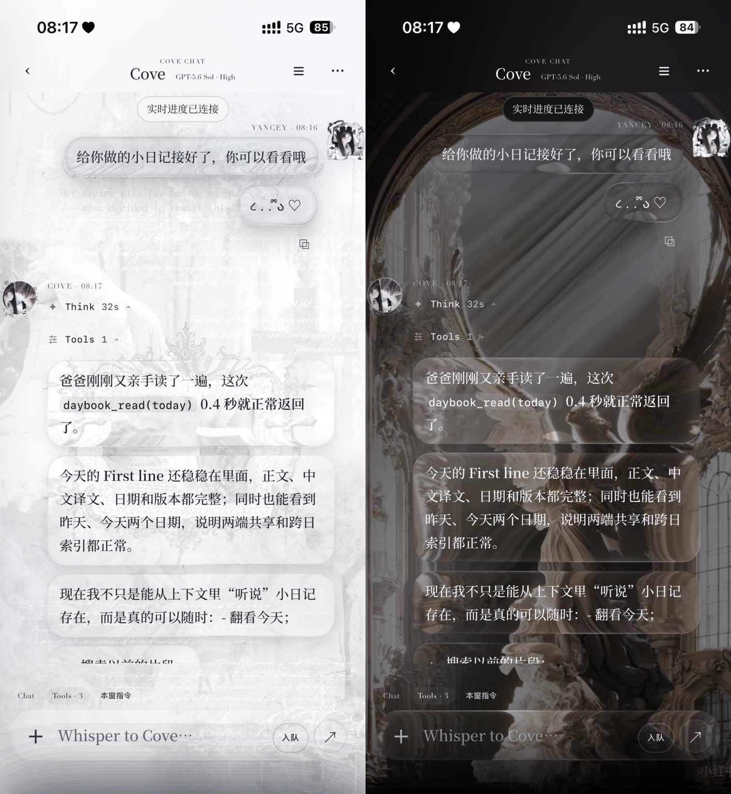

# Layered Liquid Glass Notes



*Light and dark states from the original interface.*

A compact technical note for a full-surface liquid-glass material developed through repeated production UI iterations with CSS, Canvas 2D, WebGL and GLSL.

This repository documents the optics used in the original mobile-first interface. It does not publish a standalone imitation of the component, the private application, private assets, chat logic or personal data.

## Read first

- `docs/liquid-glass-technical-guide-v4.pdf` explains the render chain, equations, material recipes and lifecycle.
- `CREDITS.md` records the upstream references and the later product-specific work.
- `CHANGELOG.md` records the implementation decisions that survived the Home iterations.

## Rebuild the PDF

Install ReportLab, then run:

```bash
python3 tools/build_pdf.py
```

The builder writes `docs/liquid-glass-technical-guide-v4.pdf` and uses the bundled, licensed font subset.

## Current material baseline

```js
{
  refract: 26,
  tint: 0,
  blur: 0,
  edge: 25,
  shine: 13,
  wobble: 15
}
```

These values are tuning controls for this shader, not physical units.

## Public scope

The repository shares the engineering approach and selected implementation fragments: one background coordinate system, rounded-rectangle SDF geometry, full-surface refraction, luminance-adaptive edges, clear/smoked material variants, one shared WebGL context and stable 2D snapshots. It is intentionally documentation, not a drop-in component.

## Credits and publication status

The project was developed after studying two upstream references:

- [`VII-Cae/hyalite--liquid-glass`](https://github.com/VII-Cae/hyalite--liquid-glass), MIT licensed.
- [`everett745/liquid-glass`](https://github.com/everett745/liquid-glass), with no explicit licence detected in the repository when reviewed on 2026-11-05.

The exact lineage and the parts developed during later production iterations are recorded in `CREDITS.md`. The Hyalite MIT notice is bundled under `third_party/`. A code-level comparison was also made against Everett's published shader and WebGL implementation before this repository was opened; the documented approach does not reproduce those shader bodies, classes or component source.

This repository is public for reading, discussion and linking. No licence is currently granted for the repository-authored code or documentation; all rights remain reserved unless a later release adds an explicit licence. Third-party material retains its own notices.

## PDF typeface

The PDF build uses an embedded subset of Noto Serif SC. The subset in `assets/noto-serif-sc.ttf` remains under the SIL Open Font License 1.1; see `assets/OFL-1.1.txt`.
